# drawn-video-board

将中文口播文案制作成手绘视频或拼贴动画的 Codex Skill。支持分镜规划、画风与角色参考、逐笔描线上色、独立图层动画、配音与语音对齐、字幕及完整视频导出，素材按 `content/<项目>/` 独立保存。

目前提供 **20 种内置画风、2 种绘制画笔、51 项可复用素材**，也可以保存自己的画风预设。分镜、画风、生图方式、新配音和完整动画预览分别确认后，再进入后续制作。

- [快速开始](#快速开始)
- [支持哪些画风](#支持哪些画风)
- [如何选择和复用画风](#如何选择和复用画风)
- [支持哪些画笔](#支持哪些画笔)
- [如何切换画笔](#如何切换画笔)
- [不用画笔如何制作拼贴动画](#不用画笔如何制作拼贴动画)
- [其他能力与详细文档](#其他能力与详细文档)

## 快速开始

需要 Python 3.11+、uv、FFmpeg 和 ffprobe；后两项需在 `PATH` 中。以下 PowerShell 命令均在仓库根目录运行：

```powershell
uv sync --locked
.\.venv\Scripts\python.exe -m cs_board_video doctor

# 不创建项目也能查看画风和画笔库
.\.venv\Scripts\python.exe -m cs_board_video style list
.\.venv\Scripts\python.exe -m cs_board_video pen list

# narration.txt 为已准备好的口播文案
.\.venv\Scripts\python.exe -m cs_board_video init --name demo --script narration.txt
```

Linux/macOS 将解释器路径替换为 `.venv/bin/python`。创建后，项目位于 `content/demo/`；后续项目命令使用 `--project content/demo`。

在 Codex 中使用时，将仓库链接到 Codex 的 `skills/drawn-video-board` 目录，以 [SKILL.md](SKILL.md) 为入口。可以直接这样提出需求：

> 使用 drawn-video-board，把 narration.txt 制作成手绘视频。先给我分镜，再展示“暖纸松弛线描风”的样图，使用钢笔。生图方式和配音另行确认，完整预览通过后再正式渲染。

基本顺序是：**创建项目 → 分镜确认 → 选择画风和画笔并确认 → 选择生图方式 → 准备并验收图片、音频 → 完整动画预览确认 → 正式渲染与合成**。有关键文字时，还需先确认字体与排字样图。完整命令流程见 [CLI 使用说明](references/cli.md)。

分镜可以用**直观、隐喻、幽默、反差、象征或夸张**表达话题，并说明与文案的关联。例如“想控制一切”可以表现为人物拿遥控器试图控制海浪。分镜阶段同时规划素材来源：用户提供的图片、按需联网检索、内置素材或新生成，可在一镜中混用。真实照片需要去背景时使用 **AI 图像编辑**，保存透明 PNG，不安装本地抠图模型。具体字段和素材记录见 [表达与素材规划](references/storyboard.md#表达与素材规划)。

## 支持哪些画风

画风决定原画的线条、配色、人物比例、材质和构图；画笔决定白板绘制时使用的持笔素材与绘制轨迹。两者可以分别选择。**“素描”“水彩”“3D 黏土”等画风名称不代表额外提供了铅笔、水彩笔或 3D 建模引擎。**

下面是当前全部内置预设。名称和 ID 都能用于 `style set --preset`；样图文件位于 `cs_board_video/upstream/web/public/styles/`。

| 样图 | 画风名称 / ID | 视觉特点 |
| --- | --- | --- |
|  | 国风动态信息图<br>`builtin-infographic` | 宣纸底、朱红重点、知识卡片与关系结构；当前共用白板占位样图 |
|  | 极简粗线简笔白板风<br>`builtin-minimal-whiteboard` | 暖白底、粗黑轮廓，橙蓝少量点缀，形体简洁 |
|  | 极简商务涂鸦风<br>`builtin-business-doodle` | 冷白底、海军蓝几何线条，流程与图表构图 |
| 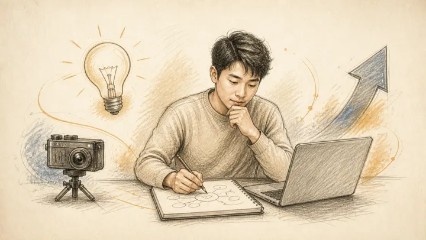 | 暖米黄素描白板风<br>`builtin-warm-pencil` | 米黄纸底、石墨线条、轻柔排线与纸张颗粒 |
| 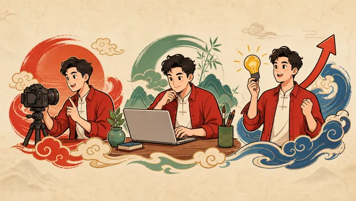 | 粗线扁平国风卡通<br>`builtin-guofeng-flat` | 深棕粗线、朱红玉绿平涂，简化国风造型 |
|  | 爆款高热吸睛风<br>`builtin-viral-pop` | 明黄底、超粗黑线、橙红钴蓝，夸张动作与强对比 |
|  | 黑金科技发布会风<br>`builtin-black-gold-tech` | 黑灰底、金色轮廓、几何数据结构与舞台光影 |
| 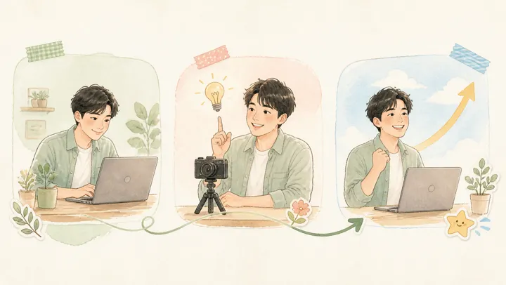 | 清新治愈手账风<br>`builtin-healing-journal` | 奶油白底、低饱和水彩、植物与手账点缀 |
|  | 复古报纸拼贴风<br>`builtin-retro-collage` | 新闻纸、黑红油墨、半色调网点与撕纸边 |
| 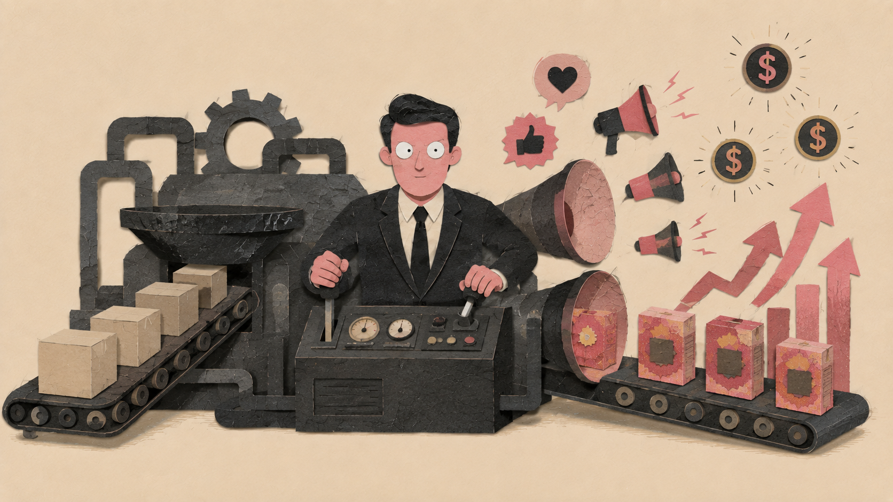 | 纸感隐喻拼贴风<br>`builtin-paper-metaphor` | 手工剪纸、纸纤维与浅投影，用具体隐喻表达观点 |
| 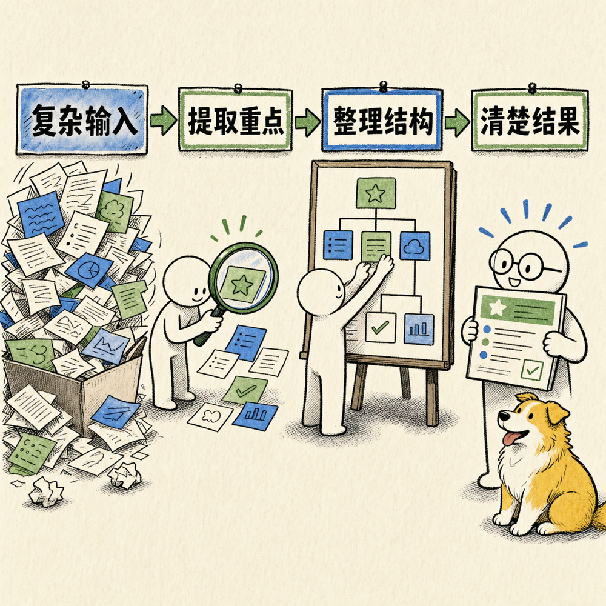 | 漫画墨线解释风<br>`builtin-oil-visual` | 粗细变化的漫画墨线、圆点半色调，适合解释概念机制 |
|  | 3D黏土趣味风<br>`builtin-clay-3d` | 圆润玩具比例、黏土质感与温暖棚拍光 |
|  | 赛博霓虹漫画风<br>`builtin-cyber-neon` | 深靛底、青紫霓虹、漫画轮廓与速度线 |
| 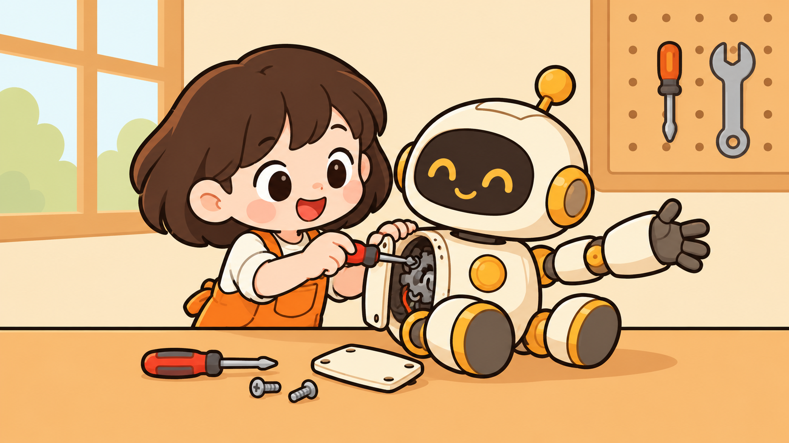 | 暖色Q版叙事漫画风<br>`builtin-warm-chibi-story` | 奶油黄、约 2.5–3 头身、封闭粗轮廓与简洁平涂 |
| 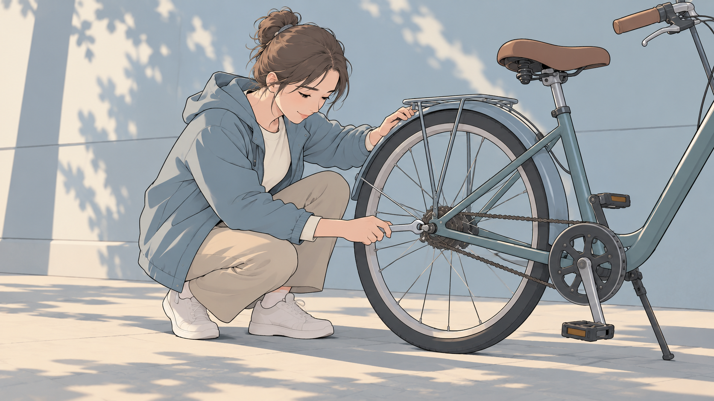 | 灰蓝写实叙事漫画风<br>`builtin-blue-gray-story` | 灰蓝淡彩、自然人物比例、细线排线与柔和侧光 |
| 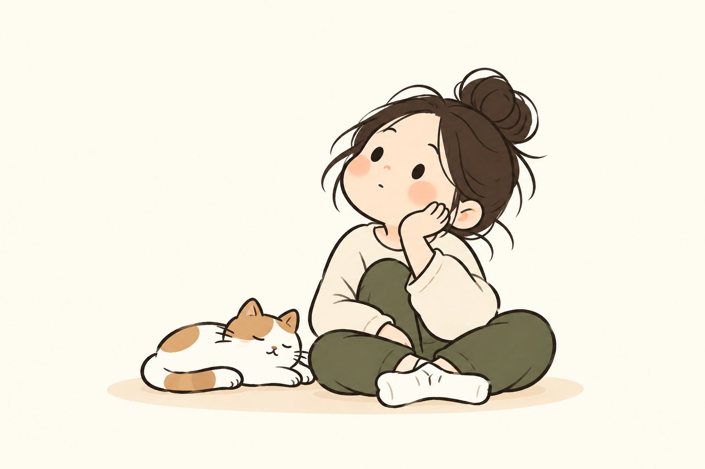 | 暖纸松弛线描风<br>`builtin-warm-paper-line` | 暖米白、橄榄绿、自然线描、简洁平涂与充分留白 |
| 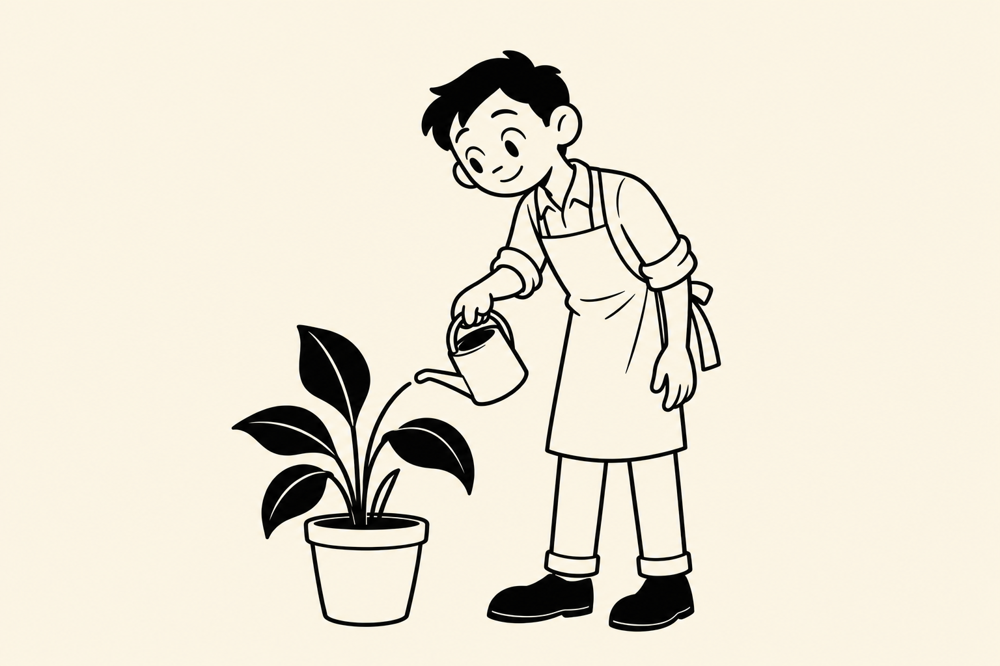 | 复古黑白线描风<br>`builtin-retro-mono-line` | 暖纸底、黑白墨线、少量黑块，无灰阶和渐变 |
| 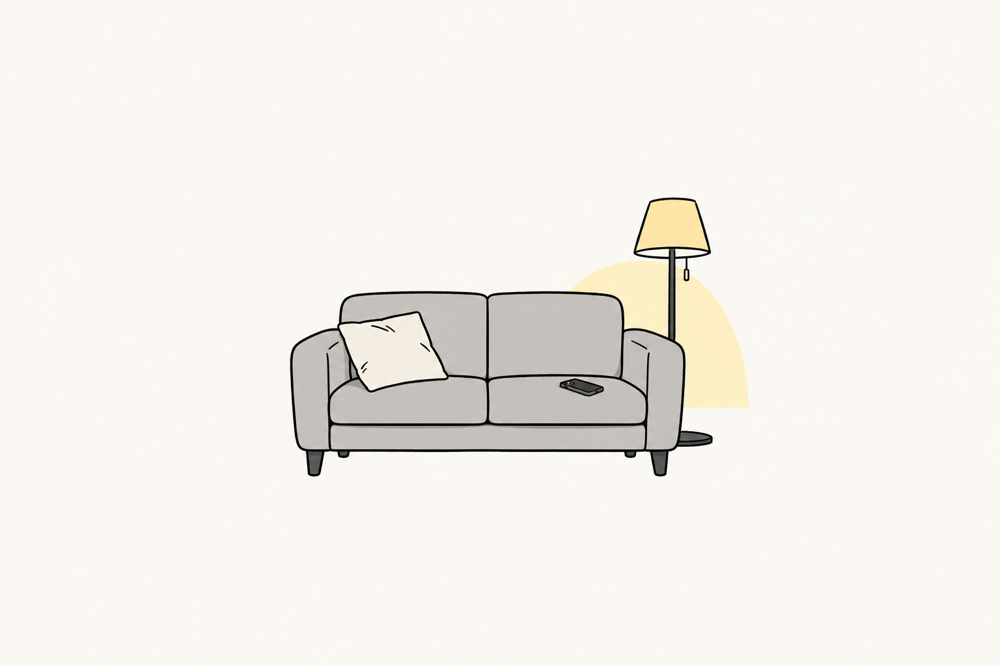 | 灰调暖光漫画风<br>`builtin-gray-warm-comic` | 黑色轮廓、灰色平涂、局部暖黄与大片留白 |
| 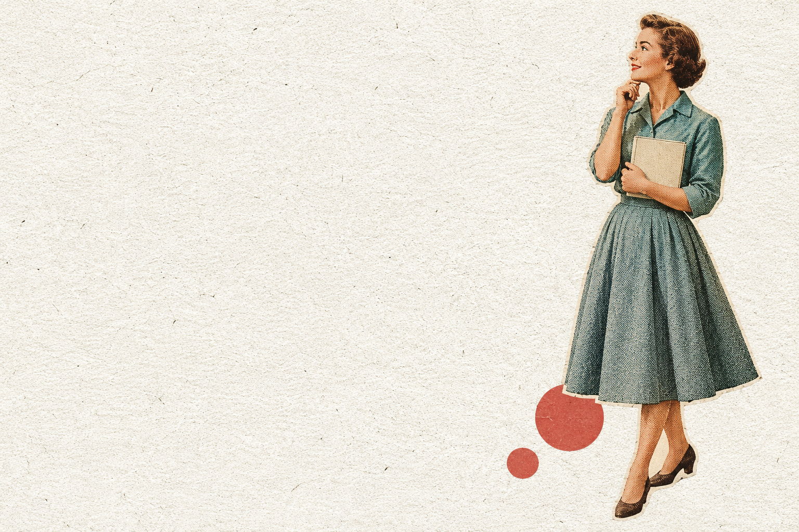 | 复古纸质人物拼贴风<br>`builtin-vintage-paper-people` | 写实比例人物剪贴、旧杂志颗粒、低饱和印刷色 |
| 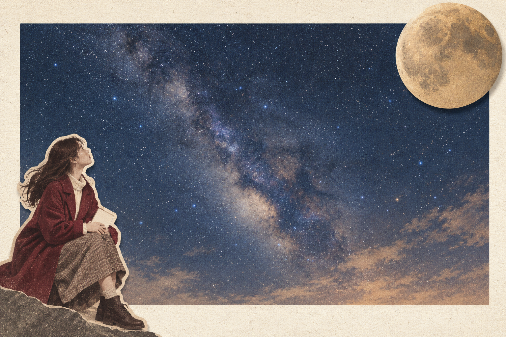 | 纸框分层拼贴风<br>`builtin-layered-paper-collage` | 暖白纸框、深色景物面板、跨框前景与遮挡层次 |

想先做线条清楚、色块简洁的手绘，可从“极简粗线简笔白板风”“暖色Q版叙事漫画风”或“暖纸松弛线描风”开始。使用钢笔时，应准备连续细线原画；纸纹、网点和复杂光影较多的画风，需要在实际预览中确认绘制节奏。

样图用于说明视觉风格，不能代表该项目已通过动画验收。“纸框分层拼贴风”的整张样图只提供静态层次；独立视差或分层运动需另备透明图层。选择“国风动态信息图”也不会自动切换渲染引擎，动态知识 PPT 需按 [CLI 使用说明](references/cli.md) 配置 Remotion 流程。

## 如何选择和复用画风

### 查看和选用内置画风

`style list` 无需项目，返回内置与本地自定义预设的名称、ID、配方、参考图路径，以及本地预设库位置。CLI 成功时返回 JSON，预设列表位于 `result.presets`。

**先完成分镜确认，再执行 `style set`。** 以下两种写法等价，任选一种：

```powershell
.\.venv\Scripts\python.exe -m cs_board_video style set --project content/demo --preset "暖纸松弛线描风"
# 或按固定 ID 选择
.\.venv\Scripts\python.exe -m cs_board_video style set --project content/demo --preset builtin-warm-paper-line
```

选择后，画风配置写入项目的 `style/style.json`，内置样图复制为 `style/preset-preview.*`。有生图参考的预设会同时注册项目参考图；预设定义了画布底色时，也会同步更新。**选用内置画风会保留当前绘制手和画笔类型**，可以接着按下文切换画笔。

选择画风、画笔后，展示项目样图与配置，再记录当前版本的画风确认：

```powershell
.\.venv\Scripts\python.exe -m cs_board_video review --project content/demo --stage style
# 用户确认当前版本后，替换为 review 返回的实际摘要和用户确认原文
.\.venv\Scripts\python.exe -m cs_board_video approve --project content/demo --stage style --digest "<实际摘要>" --user-message "<用户确认原文>"
```

画风通过后，再选择并确认生图方式，运行 `images prompts` 准备每镜提示词。使用生图工具时，将每镜 `prompt-context.json.references` 中的图片实际传入工具；仅有参考图路径不会自动完成生图。角色外形参考单独配置，选画风不会自动绑定样图中的人物。细节见 [画风与预设库](references/styles.md) 和 [图片准备](references/image-assets.md)。

### 使用自己的画风和参考图

准备 UTF-8 编码的 `style.json`，至少包含名称和画风配方：

```json
{
  "name": "我的暖纸黑线漫画",
  "recipe": "暖米白背景，连续清晰的黑色细线，低饱和橄榄绿与赭黄平涂，简化人物与道具，背景充分留白。"
}
```

分镜确认后导入；如果有独立画风参考图，再导入项目：

```powershell
.\.venv\Scripts\python.exe -m cs_board_video style set --project content/demo --file style.json
.\.venv\Scripts\python.exe -m cs_board_video asset --project content/demo --source my-reference.png --dest style/reference.png
```

替换已有参考图需显式加 `--replace`。参考图、画布底色与画笔等配置完成后，再展示并确认画风；自定义画布底色配置为 `project.json.config.canvas_hex`。

### 保存为下个项目可选的预设

自定义画风获得当前项目的画风确认后，保存到本地库：

```powershell
.\.venv\Scripts\python.exe -m cs_board_video style save --project content/demo --name "我的暖纸黑线漫画"
.\.venv\Scripts\python.exe -m cs_board_video style list

# next-video 已创建且分镜已确认后
.\.venv\Scripts\python.exe -m cs_board_video style set --project content/next-video --preset "我的暖纸黑线漫画"
```

保存包含画风配方、参考图（如有）、绘制手、画笔类型和画布底色，**不包含角色、文案、音频及批准记录**。本地库位于实际 Skill 安装目录的 `style-presets/`，默认不进入 Git；备份时复制整个目录。

`style save` 用于自定义画风，内置画风直接选用即可。同名更新需先确认来源项目的新版本，再加 `--replace`。选择自定义预设会恢复其画笔与素材，但仍需当前项目确认；更新预设库不会自动改变已经选用它的项目。

## 支持哪些画笔

| 持笔素材 | 类型 | 绘制特点 |
| --- | --- | --- |
| 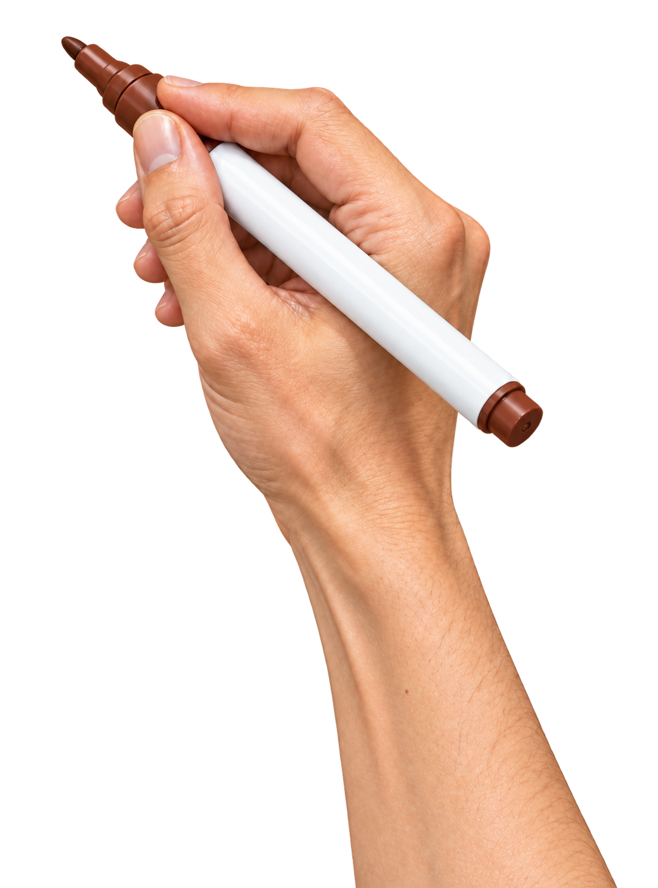 | 马克笔（默认）<br>`marker` | 白杆棕色马克笔，默认揭示半径 4 像素，适合较宽轮廓和简洁色块 |
| 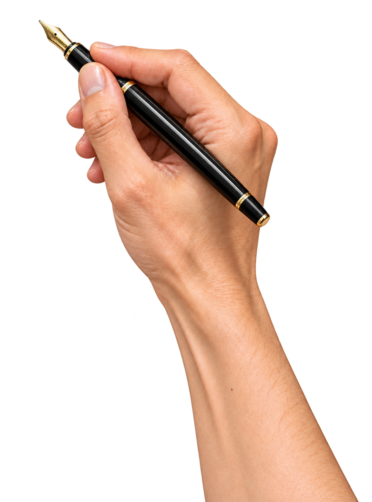 | 钢笔<br>`fountain` | 黑色笔身、金色尖笔尖，默认揭示半径 2 像素，沿笔画起收与转弯降速，适合连续细线和细节 |

两种画笔都先沿真实轮廓连续描线，再左右往返、从上向下连续落色；颜色只在笔尖经过的范围出现，抬笔移动不着色。透明分层素材可以按前后关系逐层完成描线和填色，保留遮挡、透明孔洞与半透明效果。

**钢笔需要在准备原画时就采用干净、连续的细墨线。** 已有的粗马克笔原画或照片，应重新准备合适线稿；只切换持笔图片不会把原画变成钢笔画。描线时间不足时会明确报出最少帧数，需简化线稿或调整时间。画笔选择仅用于 `whiteboard` 引擎，Remotion 分支不支持此选项。

## 如何切换画笔

查看素材及路径无需创建项目：

```powershell
.\.venv\Scripts\python.exe -m cs_board_video pen list
```

在项目中切换为钢笔，或切回默认马克笔：

```powershell
.\.venv\Scripts\python.exe -m cs_board_video pen set --project content/demo --type fountain
.\.venv\Scripts\python.exe -m cs_board_video pen set --project content/demo --type marker
```

建议在**生图前、画风确认前**选择画笔，以便提示词也使用对应要求。`pen set` 会更新 `project.json.config.pen_type`，并替换项目 `style/drawing-hand.png`；预览和正式白板渲染共用该选择。更换画笔会使当前画风批准及相关绘制缓存失效，需重新确认画风并更新受影响预览；切到钢笔时还应检查现有原画是否适用。

也可在创建项目时指定初始画笔。准备 `config.json`：

```json
{
  "pen_type": "fountain"
}
```

```powershell
.\.venv\Scripts\python.exe -m cs_board_video init --name fountain-demo --script narration.txt --config config.json
```

其他常用设置位于 `project.json.config`：`bare_tip: true` 隐藏绘制手，画笔类型仍控制轨迹宽度；`pen_text` 仅用于马克笔笔身文字。缺少 `pen_type` 的已有项目按马克笔处理，并保留已有绘制手。完整说明及独立渲染脚本参数见 [绘制画笔](references/pens.md)。

## 不用画笔如何制作拼贴动画

现在可以在创建项目时选择两种模式。**画风决定素材长什么样，模式决定素材怎么出现。** “纸框分层拼贴风”可以用于手绘，也可以把人物、道具、文字分别作为动画图层。

| 模式 | 创建方式 | 适用效果 |
| --- | --- | --- |
| 手绘，默认 | `init --mode whiteboard` | 原有逐笔描线、连续上色、马克笔或钢笔 |
| 拼贴动画 | `init --mode collage` | 固定纸纹背景，多个透明前景独立入场、叠放、摇摆、漂浮、旋转、移动和退场 |

拼贴动画使用项目已有的 **Remotion** 渲染器，Python 负责素材检查、文案时码、批准记录、缓存和 FFmpeg 音频合成，无需再安装 HyperFrames。要点如下：

- **背景独立**：使用能看到纤维、颗粒、磨损和压痕的纸纹图片贯穿整个时间轴；底色不能替代材质。纸纹之上可以放山川后景，再将人物、物品放在更高层级并与山川重叠，形成实际遮挡；转场只作用于选定前景组。
- **照片抠图**：真实照片去背景后保存为透明 PNG，就能像插画一样独立叠放和动画。当前 CLI 接收抠图成品，不内置自动抠图；详细流程与照片细节保真说明见 [前后景与照片抠图](references/collage.md#真实照片能不能抠成前景)。
- **多元素独立动画**：每个人物、物品、文字都有自己的位置、层级、开始结束时间与动画。支持淡入、滑入、缩放入场、循环摆动/漂浮/旋转，以及位置、缩放、角度、透明度关键帧。
- **跟随文案出现**：`beats` 保存真实音频时码；元素以 `anchor` 引用句子，再用 `offset_ms` 对齐具体词语。不是平均分配每句时长。
- **连续转场**：旧前景退场、新前景进入可以重叠，背景和原声保持连续，整段时长不因转场变短。

先安装 Node 和浏览器，在 `cs_board_video/upstream/video_renderer/` 执行 `npm ci`。在 Codex 中可以这样使用：

> 使用拼贴动画模式，把这段音频和文案做成 20 秒样片。使用固定粗纸纹背景，钟表、人物、书本分别作为透明图层，按关键词入场。前景之间做交叠淡化转场，保留原声。先给我完整动画预览。

CLI 入口：

```powershell
.\.venv\Scripts\python.exe -m cs_board_video init --name collage-demo --mode collage --script narration.txt
.\.venv\Scripts\python.exe -m cs_board_video collage request --project content/collage-demo
# 根据规划提示词确定表达手法、素材来源和抠图需求
# 将背景、透明 PNG、字体、已对齐音频导入项目，编写 collage-plan.json
.\.venv\Scripts\python.exe -m cs_board_video collage import --project content/collage-demo --file collage-plan.json
.\.venv\Scripts\python.exe -m cs_board_video collage validate --project content/collage-demo
.\.venv\Scripts\python.exe -m cs_board_video review --project content/collage-demo --stage collage
# 根据用户实际确认记录 collage 批准后：
.\.venv\Scripts\python.exe -m cs_board_video preview render --project content/collage-demo --resolution 1920x1080
```

完整计划示例、素材导入、批准与正式导出命令见 [拼贴动画使用说明](references/collage.md)。已有手绘项目和命令继续按原流程工作；`bare_tip: true` 仍只是隐藏手，不会切换成拼贴动画。首版支持 PNG/JPEG/WebP 和文字图层；人物运动是剪贴整体运动，不包含肢体骨骼动画、真实 3D、视频图层或自动抠图。

## 其他能力与详细文档

| 能力 | 用法与文档 |
| --- | --- |
| 项目状态与恢复 | `status --project ...` 查看进度，`resume --project ...` 继续确定性步骤，遇到创作输入或待确认阶段停止；见 [CLI](references/cli.md) |
| 关键文字与气泡 | 独立文字层、十种气泡、纯文字页及真实字体样图；见 [文字与气泡](references/typography.md) |
| 可复用素材 | `materials list` 查看 51 项气泡、标记、纸张、物件、人物、动物和场景，`materials export` 导出项目内透明 PNG；矢量素材支持改色和 SVG，见 [素材库](references/materials.md) |
| A/B-roll | 主叙事、全屏辅助镜头、画中画和返回已完成画面；见 [分镜协议](references/storyboard.md) |
| 绘制与分层 | 标注调整、任意层数独立 PNG、遮挡与逐层描线填色；见 [绘制标注](references/annotation.md) |
| 拼贴动画 | 固定背景、多元素独立动画、文案锚点和前景组转场；见 [拼贴动画](references/collage.md) |
| 音频与字幕 | 导入音频、本地 VoiceStudio 或本地模型配音、Whisper 对齐与词边界导入、字幕合成；见 [音频](references/audio.md) |
| 完整预览与验收 | [预览审核](references/preview-review.md)、[技术验证与已知边界](references/verification.md)；自动检查与实际视听验收分别记录 |

动态知识 PPT 另需 Node 和浏览器，并在 `cs_board_video/upstream/video_renderer/` 执行 `npm ci`，见 [渲染器说明](cs_board_video/upstream/video_renderer/README.md)。可选 Web 入口的安装见 [Web README](cs_board_video/upstream/web/README.md)；Codex Skill 的 CLI 工作流无需启动 Web 服务。

项目测试入口：

```powershell
.\.venv\Scripts\python.exe -m unittest discover -s tests -v
```

可选集成测试的环境变量和依赖要求见 [验证说明](references/verification.md)。
